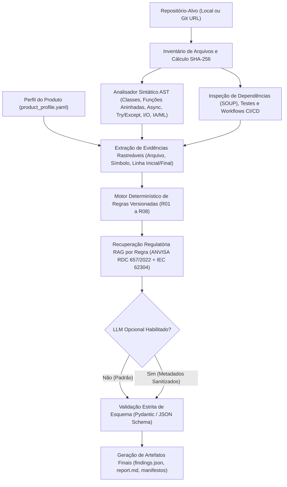

# Arquitetura do Sistema — TraceAST-62304 v1.0

> **Posicionamento Científico e Comercial:**
> *"AI-assisted, evidence-traceable pre-audit screening for medical software development repositories."*

---

## 1. Visão Geral Arquitetural

O **TraceAST-62304** foi projetado como uma ferramenta determinística, auditável e centrada em privacidade (*local-first*) para triagem pré-auditoria de repositórios Python de *Software as a Medical Device* (SaMD).

Diferentemente de abordagens que enviam código-fonte bruto para modelos de linguagem e delegam o julgamento normativo à IA generativa, o TraceAST-62304 separa estritamente:

1. **Inspeção Estrutural e Extração Sintática (Python AST):** 100% local, determinística e sem execução do código-alvo.
2. **Motor de Regras Determinísticas (`R01`–`R08`):** Avaliação reproduzível baseada em critérios explícitos e versionados (com hash SHA-256 do catálogo).
3. **Recuperação Regulatória Específica por Regra (RAG):** Indexação local da **ANVISA RDC 657/2022** (texto oficial em português) e de referências verificáveis da **IEC 62304:2006/Amd 1:2015** (via mapeamentos e templates *OpenRegulatory*), registrando *chunk IDs*, hashes SHA-256 dos documentos e *scores* de similaridade.
4. **Explicação Complementar Opcional via LLM:** Estritamente desacoplada da decisão técnica; nunca altera o `status` determinístico nem recebe código-fonte integral.

---

## 2. Diagrama do Pipeline Integrado

---

## 3. Responsabilidades dos Módulos

| Módulo | Caminho | Responsabilidade Técnica |
|---|---|---|
| **Modelos e Schemas** | `traceast/models.py` | Define os contratos de dados em Pydantic V2 (`ProductProfile`, `EvidenceItem`, `RegulatoryReference`, `Finding`, `RuleDefinition`, `FindingsReport`), garantindo que nenhum achado exista sem evidência ou justificativa explícita. |
| **Configuração e Privacidade** | `traceast/config.py` | Gerencia variáveis de ambiente, exclusão de diretórios irrelevantes (`.git`, `.venv`, `node_modules`) e proteção de arquivos sensíveis (`.env`, credenciais). |
| **Analisador Estático e AST** | `traceast/ast_analyzer.py` | Executa varredura recursiva, calcula hashes SHA-256, registra falhas de parsing (`SyntaxError`, `UnicodeDecodeError`) e percorre recursivamente a AST (incluindo funções aninhadas e métodos `async`). Inspeciona `requirements.txt`, `pyproject.toml`, `poetry.lock`, testes e `.github/workflows`. |
| **Catálogo de Regras** | `traceast/rule_catalog.py` | Define as 8 regras iniciais (`R01`–`R08`), suas consultas RAG específicas (PT/EN), limitações e referências preliminares com status `pending_expert_review`. |
| **Motor de Regras** | `traceast/rules_engine.py` | Avalia deterministicamente as evidências extraídas, verifica a existência real de cada arquivo e intervalo de linhas referenciado e emite objetos `Finding` padronizados (`TA-001` a `TA-008`). |
| **Motor RAG Regulatório** | `traceast/rag_engine.py` | Fragmenta os documentos normativos preservando página/seção/cláusula, calcula o hash SHA-256 de cada fonte e executa recuperação vetorial/híbrida local por regra (`top_k=3`), gerando `retrieval_trace.json`. |
| **Agente LLM Opcional** | `traceast/llm_agent.py` | Sanitiza os achados para impedir vazamento de código-fonte/docstrings, consulta o provedor configurado (quando habilitado), valida a saída contra `LLMExplanationOutput` e preserva o relatório determinístico em caso de falha da API. |
| **Pipeline Integrado** | `traceast/pipeline.py` | Orquestra todas as etapas de ponta a ponta sem intervenção manual, mede tempos de execução e consolida métricas. |
| **Gerador de Relatórios** | `traceast/reporting.py` | Produz `findings.json`, `report.md` (Seções A–F), `run_manifest.json`, `repository_inventory.json`, `retrieval_trace.json` e `analysis_metrics.json`. |
| **Avaliação Científica** | `traceast/evaluation.py` | Implementa geração de planilhas para dois avaliadores + adjudicador, cálculo de *Cohen's kappa*, precisão/sensibilidade/F1, intervalos de confiança *cluster bootstrap* por repositório e `Recall@3` do RAG. |
| **Interface CLI** | `traceast/cli.py` | Expõe os subcomandos `scan`, `version`, `build-rag`, `evaluate` e `test` via `python -m traceast`. |

