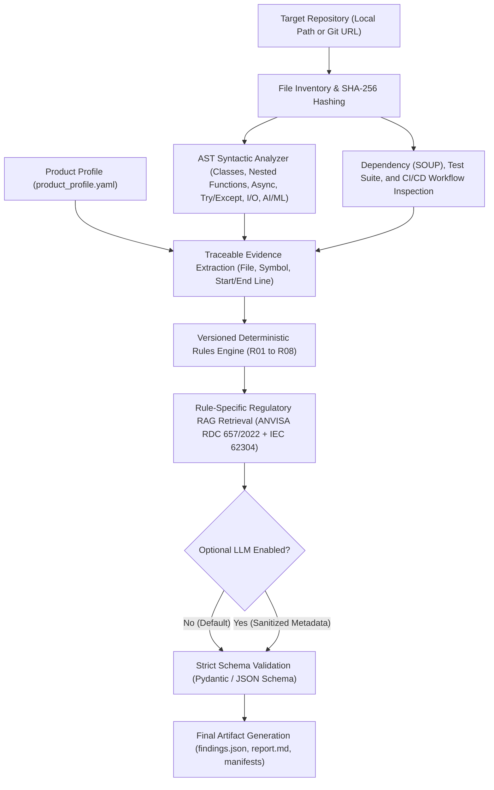

# System Architecture — TraceAST-62304 v1.0

[-blue.svg)](./ARCHITECTURE.md)
[-green.svg)](./ARCHITECTURE.pt-br.md)

> 🌐 **Language / Idioma:** **English (Primary — `ARCHITECTURE.md`)** | **[Ler em Português (`ARCHITECTURE.pt-br.md`)](./ARCHITECTURE.pt-br.md)**
> 📖 **Interactive Portal:** [Full Documentation Portal (EN)](./docs/index.html) | [Documentação Completa (PT-BR)](./docs/index.pt-br.html)

> **Scientific and Commercial Positioning:**
> *"AI-assisted, evidence-traceable pre-audit screening for medical software development repositories."*

---

## 1. Architectural Overview

**TraceAST-62304** is designed as a deterministic, auditable, and privacy-preserving (*local-first*) pre-audit screening tool for Python *Software as a Medical Device* (SaMD) repositories.

Unlike approaches that feed raw source code directly to Large Language Models and delegate regulatory judgment to generative AI, TraceAST-62304 strictly decouples:

1. **Structural Inspection and Syntactic Extraction (Python AST):** 100% local, deterministic, and without executing target code.
2. **Deterministic Rules Engine (`R01`–`R08`):** Reproducible evaluation based on explicit, versioned criteria (with a canonical SHA-256 catalog hash).
3. **Rule-Specific Regulatory Retrieval (RAG):** Local indexing of **ANVISA RDC 657/2022** (official Portuguese text) and verifiable **IEC 62304:2006/Amd 1:2015** references (via *OpenRegulatory* mappings and templates), recording chunk IDs, SHA-256 document hashes, and similarity scores.
4. **Optional Complementary LLM Explanation:** Strictly decoupled from technical decision-making; never alters the deterministic `status` and never receives raw source code.

---

## 2. Integrated Pipeline Diagram

---

## 3. Module Responsibilities

| Module | Path | Technical Responsibility |
|---|---|---|
| **Models & Schemas** | `traceast/models.py` | Defines Pydantic V2 data contracts (`ProductProfile`, `EvidenceItem`, `RegulatoryReference`, `Finding`, `RuleDefinition`, `FindingsReport`), guaranteeing that no finding exists without verifiable evidence or an explicit technical justification. |
| **Configuration & Privacy** | `traceast/config.py` | Manages environment variables, exclusion of non-project directories (`.git`, `.venv`, `node_modules`), and protection of sensitive files (`.env`, credentials). |
| **Static & AST Analyzer** | `traceast/ast_analyzer.py` | Performs recursive file discovery, computes SHA-256 hashes, records parsing failures (`SyntaxError`, `UnicodeDecodeError`), and recursively traverses the AST (including nested functions and `async` methods). Inspects `requirements.txt`, `pyproject.toml`, `poetry.lock`, tests, and `.github/workflows`. |
| **Rule Catalog** | `traceast/rule_catalog.py` | Defines the 8 core rules (`R01`–`R08`), their bilingual RAG queries (PT/EN), methodological limitations, and preliminary regulatory references marked as `pending_expert_review`. |
| **Rules Engine** | `traceast/rules_engine.py` | Deterministically evaluates extracted evidence, physically verifies every referenced file and line range, and emits standardized `Finding` objects (`TA-001` through `TA-008`). |
| **Regulatory RAG Engine** | `traceast/rag_engine.py` | Chunks normative documents while preserving page/section/clause metadata, computes SHA-256 hashes for each source, and executes local hybrid/vector retrieval per rule (`top_k=3`), generating `retrieval_trace.json`. |
| **Optional LLM Agent** | `traceast/llm_agent.py` | Sanitizes findings to prevent source code/docstring leakage, queries the configured provider (when enabled), validates outputs against `LLMExplanation`, and preserves the deterministic report if the API fails. |
| **Integrated Pipeline** | `traceast/pipeline.py` | Orchestrates all stages end-to-end without manual intervention, measures stage durations, and consolidates metrics. |
| **Report Generator** | `traceast/reporting.py` | Produces `findings.json`, `report.md` (Sections A–F), `run_manifest.json`, `repository_inventory.json`, `retrieval_trace.json`, and `analysis_metrics.json`. |
| **Scientific Evaluation** | `traceast/evaluation.py` | Generates annotation sheets for two independent reviewers + adjudicator, computes *Cohen's kappa*, Precision/Recall/F1, *cluster bootstrap* 95% confidence intervals by repository, and RAG `Recall@3`. |
| **CLI Interface** | `traceast/cli.py` | Exposes the `scan`, `version`, `build-rag`, `evaluate`, and `test` subcommands via `python -m traceast`. |
