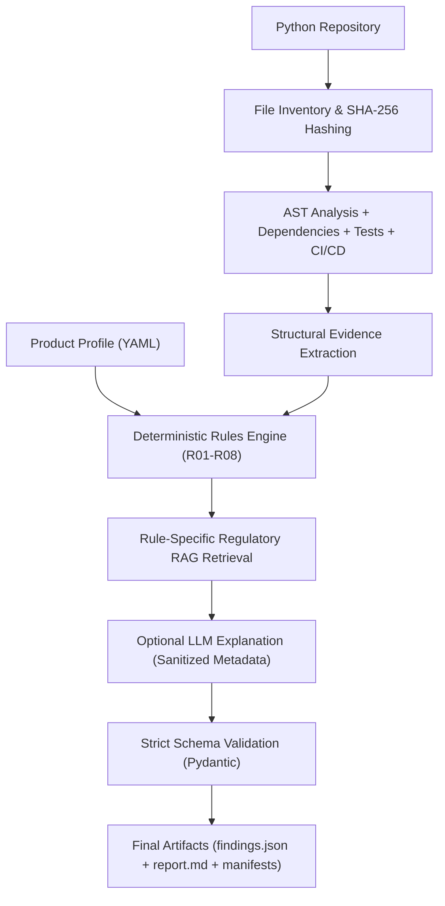

# TraceAST-62304 v1.0

[-blue.svg)](./README.md)
[-green.svg)](./README.pt-br.md)
[-0f4c81.svg)](./docs/index.html)
[-15803d.svg)](./docs/index.pt-br.html)

> 🌐 **Language / Idioma:** **English (Primary — `README.md`)** | **[Ler em Português (`README.pt-br.md`)](./README.pt-br.md)**

> **"AI-assisted, evidence-traceable pre-audit screening for medical software development repositories."**

> **Complete Technical & Didactic Documentation Portals:**
> - **In English (Primary):** Open [`docs/index.html`](./docs/index.html) in any local browser for the interactive 20-section documentation portal featuring line-by-line module explanations, a searchable variable dictionary, a 40-term beginner glossary, architecture SVG diagrams, the 8 deterministic rules (`R01`–`R08`), step-by-step mathematical metric examples, and a troubleshooting guide.
> - **Em Português (Equivalente):** Abra [`docs/index.pt-br.html`](./docs/index.pt-br.html) para a versão completa em português do portal interativo.

---

## 1. Project Name and Description

**TraceAST-62304** is an **evidence-traceable pre-audit screening assistant** for *Software as a Medical Device* (SaMD) development repositories written in Python.

The tool combines static code inspection via **Abstract Syntax Trees (AST)**, a **versioned deterministic rules engine (`R01`–`R08`)**, **rule-specific regulatory retrieval (RAG)** over **ANVISA RDC 657/2022** and verifiable **IEC 62304** references, and automated generation of structured JSON and Markdown reports.

---

## 2. Problem Statement

Academic groups, digital health startups, and medical software engineering teams frequently develop clinical algorithms and medical AI systems without early visibility into structural engineering and documentation gaps required by the **IEC 62304** software lifecycle and **ANVISA RDC 657/2022** (such as SOUP dependency control, automated testing evidence, structured I/O fault handling, input validation, model artifact version traceability, and separation between training and inference).

Conversely, submitting entire source code repositories directly to Large Language Models (LLMs) without prior deterministic extraction leads to regulatory hallucinations, loss of file/line traceability, and unnecessary exposure of proprietary source code.

---

## 3. Purpose of the Tool

To help software developers, quality engineers, and regulatory affairs professionals **proactively identify potential technical and documentation gaps** in a Python repository before submitting the project to a formal human audit, providing exact structural evidence (file path, symbol, start line, and end line) alongside verifiable normative references.

---

## 4. Mandatory Regulatory Disclaimers and Limitations

**TraceAST-62304 DOES NOT**:
1. Replace human auditors or regulatory affairs specialists.
2. Declare that a product is certified or in regulatory compliance.
3. Automatically determine the regulatory risk class of the device (RDC 657/2022 Classes I–IV) or the software safety class (IEC 62304 Classes A, B, or C).
4. Interpret the absence of evidence in the repository (`not_observed`) as proof of non-compliance.
5. Generate regulatory requirements without a verifiable reference.
6. Invent clauses, documents, features, or evidence.
7. Make claims regarding clinical performance, clinical safety, or diagnostic efficacy of models based on code analysis alone.

The system exclusively uses technical pre-audit screening expressions:
- *Evidence identified (`observed` / Evidência identificada)*
- *Partial evidence — technical indicator warranting investigation (`partial` / Evidência parcial)*
- *Evidence not identified in the analyzed repository (`not_observed` / Evidência não identificada no repositório analisado)*
- *Unable to assess with available data (`unable_to_assess` / Impossível avaliar com os dados disponíveis)*
- *Not applicable to the declared scope (`not_applicable` / Não aplicável ao escopo declarado)*
- *Human review required (`human_review_required: true` / Revisão humana necessária)*

---

## 5. Architecture

See [ARCHITECTURE.md](./ARCHITECTURE.md) (Portuguese version: [ARCHITECTURE.pt-br.md](./ARCHITECTURE.pt-br.md)) for the detailed architectural specification. The system is organized into four decoupled layers:
1. **Static Inspection & AST Layer (`traceast/ast_analyzer.py`):** Recursive Python file discovery, SHA-256 hashing, parse coverage and failure accounting, recursive AST traversal of classes, methods, top-level functions, nested functions, and asynchronous methods (`async def`), plus inspection of `requirements.txt`/`pyproject.toml`/`poetry.lock`, test suites, and CI/CD workflows.
2. **Deterministic Rules Layer (`traceast/rule_catalog.py`, `traceast/rules_engine.py`):** Versioned catalog of 8 deterministic rules (`R01`–`R08`) with physical file and line-range integrity verification (see [RULE_CATALOG.md](./RULE_CATALOG.md) | [Português](./RULE_CATALOG.pt-br.md)).
3. **Local Regulatory Retrieval Layer (`traceast/rag_engine.py`):** Traceable chunking of ANVISA RDC 657/2022 (official Portuguese text) and IEC 62304 templates/mappings, executing rule-specific queries (`top_k=3`) with `chunk_id`, page/section, SHA-256 document hash, and similarity score tracking.
4. **Optional Explanation & Reporting Layer (`traceast/llm_agent.py`, `traceast/reporting.py`):** Generation of `findings.json`, `report.md`, `run_manifest.json`, `repository_inventory.json`, `retrieval_trace.json`, and `analysis_metrics.json`. The LLM module is strictly optional and never modifies deterministic statuses.

---

## 6. Pipeline Diagram



---

## 7. Module Structure & Bilingual Documentation Map

```text
TraceAST-62304-Poc/
├── traceast/
│   ├── __init__.py                 # Package version and metadata
│   ├── __main__.py                 # Entry point: python -m traceast
│   ├── cli.py                      # Command-line interface (scan, version, build-rag, evaluate, test)
│   ├── config.py                   # Environment settings, privacy controls, and product_profile.yaml loader
│   ├── models.py                   # Pydantic V2 schemas for findings, evidence, and references
│   ├── ast_analyzer.py             # Recursive AST analyzer and dependency/test/CI inspector
│   ├── rule_catalog.py             # Versioned catalog of rules R01 through R08
│   ├── rules_engine.py             # Deterministic rule evaluation engine
│   ├── rag_engine.py               # Per-rule RAG indexer and retriever with provenance tracking
│   ├── llm_agent.py                # Optional AI-assisted explanation module with guardrails
│   ├── pipeline.py                 # End-to-end pre-audit pipeline orchestrator
│   ├── reporting.py                # Generator of findings.json, report.md, and reproducibility manifests
│   └── evaluation.py               # Scientific scoring engine, Cohen's kappa, Bootstrap CI, and Recall@3
├── legal_documents/                # RDC_657_2022.pdf (ANVISA) and IEC 62304 templates (OpenRegulatory)
├── docs/
│   ├── index.html                  # Interactive Technical & Didactic Documentation Portal (English - Primary)
│   ├── index.pt-br.html            # Interactive Technical & Didactic Documentation Portal (Portuguese)
│   ├── styles.css                  # Responsive documentation portal stylesheet
│   └── app.js                      # Real-time global search, variable filter, and glossary filter (Bilingual)
├── tests/
│   ├── fixtures/                   # Controlled synthetic repositories for positive, deficient, and negative testing
│   └── test_traceast_suite.py
├── README.md                       # Primary English README (Portuguese: README.pt-br.md)
├── ARCHITECTURE.md                 # System Architecture in English (Portuguese: ARCHITECTURE.pt-br.md)
├── RULE_CATALOG.md                 # Deterministic Rule Catalog in English (Portuguese: RULE_CATALOG.pt-br.md)
├── VALIDATION_PROTOCOL.md          # Scientific Validation Protocol in English (Portuguese: VALIDATION_PROTOCOL.pt-br.md)
├── REPRODUCIBILITY.md              # Reproducibility Guide in English (Portuguese: REPRODUCIBILITY.pt-br.md)
├── LIMITATIONS.md                  # Technical & Regulatory Limitations in English (Portuguese: LIMITATIONS.pt-br.md)
├── product_profile.example.yaml
├── requirements.txt
└── pyproject.toml
```

### Bilingual Documentation Index

| Document | English (Primary) | Português (pt-BR) |
|---|---|---|
| **Interactive Documentation Portal (20 Sections)** | [`docs/index.html`](./docs/index.html) | [`docs/index.pt-br.html`](./docs/index.pt-br.html) |
| **Main Repository Guide (README)** | [`README.md`](./README.md) | [`README.pt-br.md`](./README.pt-br.md) |
| **System Architecture** | [`ARCHITECTURE.md`](./ARCHITECTURE.md) | [`ARCHITECTURE.pt-br.md`](./ARCHITECTURE.pt-br.md) |
| **Deterministic Rule Catalog (`R01`–`R08`)** | [`RULE_CATALOG.md`](./RULE_CATALOG.md) | [`RULE_CATALOG.pt-br.md`](./RULE_CATALOG.pt-br.md) |
| **Scientific Validation Protocol** | [`VALIDATION_PROTOCOL.md`](./VALIDATION_PROTOCOL.md) | [`VALIDATION_PROTOCOL.pt-br.md`](./VALIDATION_PROTOCOL.pt-br.md) |
| **Scientific Reproducibility Guide** | [`REPRODUCIBILITY.md`](./REPRODUCIBILITY.md) | [`REPRODUCIBILITY.pt-br.md`](./REPRODUCIBILITY.pt-br.md) |
| **Technical & Regulatory Limitations** | [`LIMITATIONS.md`](./LIMITATIONS.md) | [`LIMITATIONS.pt-br.md`](./LIMITATIONS.pt-br.md) |

---

## 8. Prerequisites

- **Python:** 3.11 or higher (tested on Python 3.13).
- **Git:** Required only when `--repo` points to a remote URL.
- **External API:** **Not required.** The entire deterministic pipeline and local RAG run 100% offline.

---

## 9. Installation

```bash
git clone https://github.com/Vitor-Benosse/TraceAST-62304-Poc.git
cd TraceAST-62304-Poc
python -m venv venv
# Windows PowerShell:
.\venv\Scripts\Activate.ps1
# Linux / macOS:
source venv/bin/activate

python -m pip install -r requirements.txt
```

---

## 10. Environment Variable Configuration

Copy `.env.example` to `.env` if you wish to customize paths or enable the optional LLM module:

```bash
cp .env.example .env
```

Key variables in `.env`:
- `TRACEAST_ENABLE_LLM="false"` (default `false`; guarantees 100% local execution).
- `TRACEAST_ALLOW_CODE_EXCERPTS="false"` (default `false`; masks internal file/symbol names when using the LLM).
- `GROQ_API_KEY` and `GROQ_MODEL`: used only when `--with-llm` or `TRACEAST_ENABLE_LLM="true"` is active.

---

## 11. Running an Analysis

Default execution (deterministic AST rules + local RAG, without LLM):
```bash
python -m traceast scan --repo ./tests/fixtures/repo_well_structured --profile ./product_profile.example.yaml --out ./reports/run001
```

Static rules only (without RAG and without LLM):
```bash
python -m traceast scan --repo ./tests/fixtures/repo_well_structured --no-rag --out ./reports/run_no_rag
```

Execution with optional LLM contextual explanations:
```bash
python -m traceast scan --repo ./tests/fixtures/repo_well_structured --profile ./product_profile.example.yaml --with-llm --out ./reports/run_llm
```

Display tool version and SHA-256 hash of the rule catalog:
```bash
python -m traceast version
```

---

## 12. Product Profile Example (`product_profile.example.yaml`)

```yaml
product:
  name: "ChestXRay-AI-Diagnostic-Support"
  intended_purpose: "Auxílio à triagem de radiografias torácicas em ambiente hospitalar por médicos radiologistas"
  intended_users: "Médicos radiologistas e clínicos devidamente habilitados"
  target_market:
    - Brazil
  software_type: "AI-enabled SaMD"
  ai_components: true
  clinical_decision_context: "Suporte informativo à elaboração de laudos radiológicos; não substitui a interpretação médica final"
```

Unknown fields may be set to `"unknown"`; the tool automatically records the resulting scope limitations in the output report.

---

## 13. Example Output (`findings.json` — Excerpt)

```json
{
  "finding_id": "TA-005",
  "rule_id": "R05",
  "title": "Tratamento de erros e exceções em operações de I/O",
  "category": "Confiabilidade e Tratamento de Falhas",
  "status": "observed",
  "status_label_pt": "Evidência identificada",
  "review_priority": "medium",
  "confidence": "high",
  "description": "Evidência identificada: todas as 1 operação(ões) candidatas de I/O detectadas estão inseridas em blocos try-except não vazios, sem blocos except silenciosos (pass).",
  "justification": "1/1 chamadas de I/O possuem estrutura sintática try-except local. A presença sintática não comprova adequação do controle de risco.",
  "evidence": [
    {
      "file": "src/data_io.py",
      "symbol": "safe_load_dicom",
      "line_start": 25,
      "line_end": 25,
      "evidence_type": "ast_io_operation",
      "description": "Operação candidata de I/O 'pydicom.dcmread' em 'safe_load_dicom' (dentro de try-except não vazio: True)"
    }
  ],
  "human_review_required": true
}
```

---

## 14. Running Automated Tests

```bash
python -m pytest -v
```
Or directly via the CLI:
```bash
python -m traceast test
```

---

## 15. Output Artifacts Structure

Each execution targeting `--out ./reports/run001` generates 6 structured files:
- `findings.json`: All findings validated against the Pydantic schema, including evidence items, regulatory references, and product profile.
- `report.md`: Human-readable report organized into Sections A (Identification), B (Analysis Integrity), C (Overview), D (Detailed Findings), E (Regulatory References), and F (Action Plan).
- `run_manifest.json`: Reproducibility metadata (tool version, Python version, Git commit SHA, SHA-256 rule catalog hash, SHA-256 regulatory document hashes, parameters, and stage durations).
- `repository_inventory.json`: Complete inventory of inspected files, individual SHA-256 hashes, failed files, dependencies, and test/CI configurations.
- `retrieval_trace.json`: Complete trace of per-rule RAG queries, retrieved chunks, and similarity scores.
- `analysis_metrics.json`: Consolidated structural counts.

---

## 16. Technical Limitations

See [LIMITATIONS.md](./LIMITATIONS.md) ([Português](./LIMITATIONS.pt-br.md)) for the full declaration. In summary:
- Scope restricted to Python in V1.0.
- Static analysis does not execute code or evaluate dynamic runtime data flows in production.
- Normative mappings carry `pending_expert_review` status until formal specialist sign-off.

---

## 17. Privacy and Security Notices

- **Safe Local Execution:** Target repository code is never executed (`import` or `exec`), and its dependencies are never automatically installed.
- **Secret Protection:** `.env` files and credential files inside the target repository are automatically excluded, and API keys are never written to logs or manifests.
- **External Service Control:** No data is transmitted to external APIs unless the user explicitly enables `--with-llm` (or `TRACEAST_ENABLE_LLM=true`). Even when enabled, full source code and docstrings are never transmitted.

---

## 18. How to Contribute and Reproduce Experiments

See [REPRODUCIBILITY.md](./REPRODUCIBILITY.md) ([Português](./REPRODUCIBILITY.pt-br.md)) and [VALIDATION_PROTOCOL.md](./VALIDATION_PROTOCOL.md) ([Português](./VALIDATION_PROTOCOL.pt-br.md)) for step-by-step clean-room reproduction instructions and scientific evaluation artifact generation (`python -m traceast evaluate --out ./evaluation_artifacts`).
