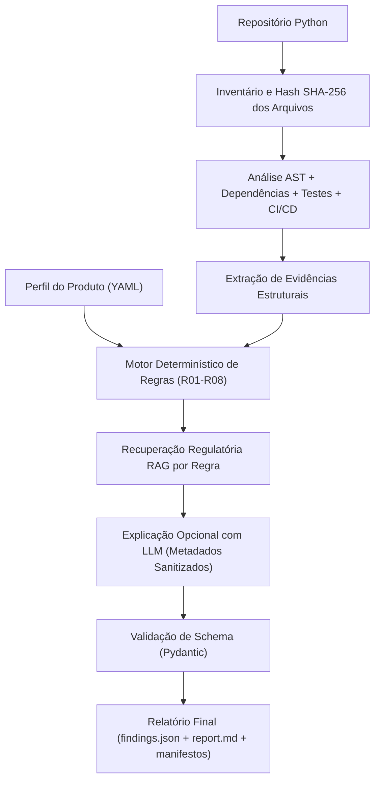

# TraceAST-62304 v1.0 (Português)

[-blue.svg)](./README.md)
[-green.svg)](./README.pt-br.md)
[-0f4c81.svg)](./docs/index.pt-br.html)
[-1e293b.svg)](./docs/index.html)

> 🌐 **Language / Idioma:** **[Read in English (Primary) — `README.md`](./README.md)** | **Português (`README.pt-br.md`)**

> **"AI-assisted, evidence-traceable pre-audit screening for medical software development repositories."**

> **Documentação Técnica e Didática Completa:**
> - **Em Português:** Abra [`docs/index.pt-br.html`](./docs/index.pt-br.html) em qualquer navegador local para acessar o portal interativo em português com explicação linha a linha dos módulos, dicionário pesquisável de variáveis, glossário para iniciantes, diagramas de fluxo, catálogo das 8 regras (`R01`–`R08`), explicação matemática das métricas e guia de troubleshooting.
> - **In English:** Open [`docs/index.html`](./docs/index.html) for the complete interactive documentation portal in English.

---

## 1. Nome e Descrição do Projeto

O **TraceAST-62304** é um assistente técnico de **triagem pré-auditoria baseado em evidências rastreáveis** para repositórios de desenvolvimento de *Software as a Medical Device* (SaMD) escritos em Python.

A ferramenta combina inspeção estática via **Abstract Syntax Trees (AST)**, um **motor determinístico de regras versionadas (`R01`–`R08`)**, **recuperação regulatória específica por regra (RAG)** sobre a **ANVISA RDC 657/2022** e referências verificáveis da **IEC 62304**, e geração automatizada de relatórios estruturados em JSON e Markdown.

---

## 2. Problema que o TraceAST-62304 Pretende Resolver

Equipes acadêmicas, startups de saúde digital e desenvolvedores de software médico frequentemente desenvolvem algoritmos clínicos e sistemas de IA médica sem visibilidade precoce sobre lacunas estruturais de engenharia e documentação exigidas pelo ciclo de vida da **IEC 62304** e pela **RDC 657/2022 da ANVISA** (como controle de dependências SOUP, evidências de testes automatizados, tratamento estruturado de falhas de I/O, validação de entradas, rastreabilidade de versão de modelos e desacoplamento entre treinamento e inferência).

Por outro lado, submeter repositórios inteiros diretamente a Modelos de Linguagem (LLMs) sem extração determinística prévia gera alucinações normativas, perda de rastreabilidade de linhas/arquivos e exposição desnecessária de propriedade intelectual.

---

## 3. Finalidade da Ferramenta

Auxiliar desenvolvedores, engenheiros de qualidade e profissionais de assuntos regulatórios a **identificar antecipadamente possíveis lacunas técnicas e documentais** em um repositório Python antes de encaminhar o projeto para uma auditoria humana formal, fornecendo evidências exatas (arquivo, símbolo, linha inicial e final) e referências normativas verificáveis.

---

## 4. Limitações e Avisos Regulatórios Obrigatórios

O **TraceAST-62304 NÃO**:
1. Substitui auditores humanos ou especialistas em assuntos regulatórios.
2. Declara que um produto está certificado ou em conformidade regulatória.
3. Determina automaticamente a classe regulatória do dispositivo (RDC 657/2022) ou a classe de segurança do software (IEC 62304 Classes A, B ou C).
4. Interpreta a ausência de evidência no código (`not_observed`) como prova de não conformidade.
5. Gera exigências regulatórias sem referência verificável.
6. Inventa cláusulas, documentos, funcionalidades ou evidências.
7. Faz afirmações sobre desempenho clínico, segurança clínica ou eficácia diagnóstica de modelos.

O sistema utiliza exclusivamente expressões técnicas de triagem:
- *Evidência identificada (`observed`)*
- *Evidência parcial — indicador técnico que merece investigação (`partial`)*
- *Evidência não identificada no repositório analisado (`not_observed`)*
- *Impossível avaliar com os dados disponíveis (`unable_to_assess`)*
- *Não aplicável ao escopo declarado (`not_applicable`)*
- *Revisão humana necessária (`human_review_required: true`)*

---

## 5. Arquitetura

Consulte [ARCHITECTURE.pt-br.md](./ARCHITECTURE.pt-br.md) (ou [ARCHITECTURE.md](./ARCHITECTURE.md) em inglês) para a descrição arquitetural detalhada. A arquitetura é dividida em quatro camadas desacopladas:
1. **Camada de Inspeção Estática e AST (`traceast/ast_analyzer.py`):** Varredura recursiva de arquivos Python, cálculo de SHA-256, contabilização de cobertura e falhas de parsing, visita recursiva a classes, métodos, funções de primeiro nível, funções aninhadas e métodos assíncronos (`async def`), além de inspeção de `requirements.txt`/`pyproject.toml`/`poetry.lock`, suítes de teste e workflows de CI/CD.
2. **Camada Determinística de Regras (`traceast/rule_catalog.py`, `traceast/rules_engine.py`):** Catálogo versionado de 8 regras (`R01`–`R08`) com verificação de integridade de arquivos e linhas (veja [RULE_CATALOG.pt-br.md](./RULE_CATALOG.pt-br.md)).
3. **Camada de Recuperação Regulatória Local (`traceast/rag_engine.py`):** Fragmentação rastreável da RDC 657/2022 (texto oficial em português) e templates/mapeamentos da IEC 62304, realizando consultas específicas por regra (`top_k=3`) com registro de `chunk_id`, página/seção, hash SHA-256 e score de similaridade.
4. **Camada de Explicação Opcional e Relatórios (`traceast/llm_agent.py`, `traceast/reporting.py`):** Geração de `findings.json`, `report.md`, `run_manifest.json`, `repository_inventory.json`, `retrieval_trace.json` e `analysis_metrics.json`. O LLM é estritamente opcional e nunca altera o status determinístico.

---

## 6. Diagrama do Pipeline



---

## 7. Estrutura dos Módulos e Documentação Bilíngue

```text
TraceAST-62304-Poc/
├── traceast/
│   ├── __init__.py                 # Versão e metadados do pacote
│   ├── __main__.py                 # Ponto de entrada: python -m traceast
│   ├── cli.py                      # Interface de linha de comando (scan, version, build-rag, evaluate, test)
│   ├── config.py                   # Configurações, privacidade e leitor de product_profile.yaml
│   ├── models.py                   # Schemas Pydantic V2 para achados, evidências e referências
│   ├── ast_analyzer.py             # Analisador AST recursivo e inspetor de dependências/testes/CI
│   ├── rule_catalog.py             # Catálogo versionado das regras R01 a R08
│   ├── rules_engine.py             # Motor determinístico de avaliação das regras
│   ├── rag_engine.py               # Indexador e recuperador RAG por regra com rastreabilidade
│   ├── llm_agent.py                # Módulo opcional de explicação assistida por IA com guardrails
│   ├── pipeline.py                 # Orquestrador ponta a ponta do fluxo de pré-auditoria
│   ├── reporting.py                # Gerador de findings.json, report.md e manifestos
│   └── evaluation.py               # Motor de pontuação científica, Cohen's kappa, Bootstrap CI e Recall@3
├── legal_documents/                # RDC_657_2022.pdf (ANVISA) e templates IEC 62304 (OpenRegulatory)
├── docs/
│   ├── index.html                  # Portal interativo de documentação técnica e didática (Inglês - Principal)
│   ├── index.pt-br.html            # Portal interativo de documentação técnica e didática (Português)
│   ├── styles.css                  # Estilos responsivos do portal de documentação
│   └── app.js                      # Busca global em tempo real, filtro de variáveis e filtro de glossário (Bilíngue)
├── tests/
│   ├── fixtures/                   # Repositórios fictícios controlados para validação positiva e negativa
│   └── test_traceast_suite.py
├── README.md / README.pt-br.md
├── ARCHITECTURE.md / ARCHITECTURE.pt-br.md
├── RULE_CATALOG.md / RULE_CATALOG.pt-br.md
├── VALIDATION_PROTOCOL.md / VALIDATION_PROTOCOL.pt-br.md
├── REPRODUCIBILITY.md / REPRODUCIBILITY.pt-br.md
├── LIMITATIONS.md / LIMITATIONS.pt-br.md
├── product_profile.example.yaml
├── requirements.txt
└── pyproject.toml
```

---

## 8. Pré-requisitos

- **Python:** 3.11 ou superior (testado em Python 3.13).
- **Git:** Necessário apenas quando o parâmetro `--repo` apontar para uma URL remota.
- **API Externa:** **Não obrigatória.** Todo o pipeline determinístico e o RAG funcionam 100% localmente.

---

## 9. Instalação

```bash
git clone https://github.com/Vitor-Benosse/TraceAST-62304-Poc.git
cd TraceAST-62304-Poc
python -m venv venv
# Windows PowerShell:
.\venv\Scripts\Activate.ps1
# Linux / macOS:
source venv/bin/activate

python -m pip install -r requirements.txt
```

---

## 10. Configuração das Variáveis de Ambiente

Copie o arquivo `.env.example` para `.env` caso deseje customizar configurações ou habilitar o LLM opcional:

```bash
cp .env.example .env
```

Principais variáveis em `.env`:
- `TRACEAST_ENABLE_LLM="false"` (padrão `false`; garante execução 100% local).
- `TRACEAST_ALLOW_CODE_EXCERPTS="false"` (padrão `false`; mascara nomes internos ao usar LLM).
- `GROQ_API_KEY` e `GROQ_MODEL`: utilizados somente quando `--with-llm` ou `TRACEAST_ENABLE_LLM="true"` estiver ativo.

---

## 11. Execução de uma Análise

Execução padrão (determinística + RAG local, sem LLM):
```bash
python -m traceast scan --repo ./tests/fixtures/repo_well_structured --profile ./product_profile.example.yaml --out ./reports/run001
```

Execução apenas com regras estáticas (sem RAG e sem LLM):
```bash
python -m traceast scan --repo ./tests/fixtures/repo_well_structured --no-rag --out ./reports/run_no_rag
```

Execução com explicações complementares do LLM:
```bash
python -m traceast scan --repo ./tests/fixtures/repo_well_structured --profile ./product_profile.example.yaml --with-llm --out ./reports/run_llm
```

Consultar versão e hash do catálogo de regras:
```bash
python -m traceast version
```

---

## 12. Exemplo de Perfil do Produto (`product_profile.example.yaml`)

```yaml
product:
  name: "ChestXRay-AI-Diagnostic-Support"
  intended_purpose: "Auxílio à triagem de radiografias torácicas em ambiente hospitalar por médicos radiologistas"
  intended_users: "Médicos radiologistas e clínicos devidamente habilitados"
  target_market:
    - Brazil
  software_type: "AI-enabled SaMD"
  ai_components: true
  clinical_decision_context: "Suporte informativo à elaboração de laudos radiológicos; não substitui a interpretação médica final"
```

Campos desconhecidos podem ser preenchidos como `"unknown"`; a ferramenta registrará automaticamente as limitações decorrentes no relatório.

---

## 13. Exemplo de Relatório (`findings.json` — Trecho)

```json
{
  "finding_id": "TA-005",
  "rule_id": "R05",
  "title": "Tratamento de erros e exceções em operações de I/O",
  "category": "Confiabilidade e Tratamento de Falhas",
  "status": "observed",
  "status_label_pt": "Evidência identificada",
  "review_priority": "medium",
  "confidence": "high",
  "description": "Evidência identificada: todas as 1 operação(ões) candidatas de I/O detectadas estão inseridas em blocos try-except não vazios, sem blocos except silenciosos (pass).",
  "justification": "1/1 chamadas de I/O possuem estrutura sintática try-except local. A presença sintática não comprova adequação do controle de risco.",
  "evidence": [
    {
      "file": "src/data_io.py",
      "symbol": "safe_load_dicom",
      "line_start": 25,
      "line_end": 25,
      "evidence_type": "ast_io_operation",
      "description": "Operação candidata de I/O 'pydicom.dcmread' em 'safe_load_dicom' (dentro de try-except não vazio: True)"
    }
  ],
  "human_review_required": true
}
```

---

## 14. Execução dos Testes

```bash
python -m pytest -v
```
Ou diretamente pela CLI:
```bash
python -m traceast test
```

---

## 15. Estrutura dos Resultados

Cada execução em `--out ./reports/run001` produz:
- `findings.json`: Todos os achados validados pelo schema Pydantic, evidências, referências e perfil do produto.
- `report.md`: Relatório legível organizado nas seções A (Identificação), B (Integridade da Análise), C (Visão Geral), D (Achados Detalhados), E (Referências Regulatórias) e F (Plano de Ação).
- `run_manifest.json`: Metadados de reprodutibilidade (versão, Python, commit SHA, hash SHA-256 das regras, hashes SHA-256 dos documentos normativos, parâmetros e tempos).
- `repository_inventory.json`: Inventário completo de arquivos analisados, hashes SHA-256 individuais, arquivos com falha, dependências e configurações de teste/CI.
- `retrieval_trace.json`: Rastreamento completo das consultas RAG por regra, fragmentos recuperados e scores.
- `analysis_metrics.json`: Contagens estruturais consolidadas.

---

## 16. Limitações Técnicas

Consulte [LIMITATIONS.pt-br.md](./LIMITATIONS.pt-br.md) (ou [LIMITATIONS.md](./LIMITATIONS.md) em inglês) para a lista completa. Em síntese:
- Escopo restrito a Python na V1.0.
- Análise estática não executa código nem avalia fluxo dinâmico de dados em produção.
- Correspondências normativas possuem status `pending_expert_review` até validação formal por especialista.

---

## 17. Avisos sobre Privacidade e Segurança

- **Execução Local Segura:** O código do repositório analisado nunca é executado (`import` ou `exec`), e suas dependências nunca são instaladas automaticamente.
- **Proteção de Segredos:** Arquivos `.env` e credenciais do repositório analisado são ignorados automaticamente, e chaves de API nunca são gravadas nos logs ou manifestos.
- **Controle sobre Serviços Externos:** Nenhum dado é enviado a APIs externas a menos que o usuário ative explicitamente `--with-llm` (ou `TRACEAST_ENABLE_LLM=true`). Mesmo quando ativo, o código-fonte integral e docstrings nunca são enviados.

---

## 18. Como Contribuir e Reproduzir os Experimentos

Consulte [REPRODUCIBILITY.pt-br.md](./REPRODUCIBILITY.pt-br.md) e [VALIDATION_PROTOCOL.pt-br.md](./VALIDATION_PROTOCOL.pt-br.md) (ou em inglês: [REPRODUCIBILITY.md](./REPRODUCIBILITY.md) e [VALIDATION_PROTOCOL.md](./VALIDATION_PROTOCOL.md)) para instruções passo a passo de reprodução em ambiente limpo e geração dos artefatos de avaliação científica (`python -m traceast evaluate --out ./evaluation_artifacts`).
